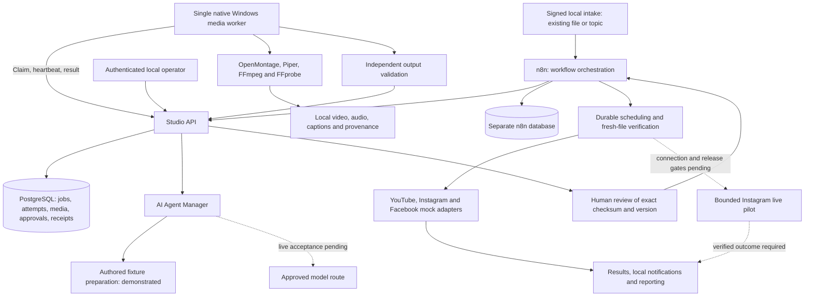

# Social Studio

**A self-hosted, multi-brand content production and automation platform built around OpenMontage, n8n and PostgreSQL.**

Social Studio connects content intake, editorial preparation, video production, quality control, human approval, scheduling and platform delivery through one traceable workflow. Its goal is to give a creator or internal content team a repeatable production process while keeping control of brand identity, media rights, credentials, costs and release decisions.

The project has progressed from architecture and engine evaluation to actual rendered videos and a verified local automation pipeline. The next delivery boundaries are real-model acceptance and a narrowly scoped Instagram connection/publishing pilot.

> **Status snapshot: 5 November 2026.** This README consolidates source and saved evidence through 4 November 2026, reviewed from baseline `51bcda4`. Real videos and local n8n/PostgreSQL workflows have been demonstrated. AI responses in accepted production runs are authored fixtures; social publishing results are mocks. Instagram Unified Login is connection-only; account authorization and public posting are not recorded as complete. This is a delivery record, not a fresh runtime health check or a new authorization to operate services.

## Contents

- [Business purpose and goals](#business-purpose-and-goals)
- [Scope and current capability](#scope-and-current-capability)
- [Solution architecture](#solution-architecture)
- [Automation process](#automation-process)
- [Delivery phases and achievements](#delivery-phases-and-achievements)
- [Problems investigated and fixes delivered](#problems-investigated-and-fixes-delivered)
- [Evidence and validation](#evidence-and-validation)
- [Remaining work and delivery gates](#remaining-work-and-delivery-gates)
- [Project management and acceptance](#project-management-and-acceptance)
- [Local development and operations](#local-development-and-operations)
- [Repository structure](#repository-structure)
- [Security, rights and operational risks](#security-rights-and-operational-risks)
- [Project documentation](#project-documentation)

## Business purpose and goals

Content production often involves disconnected steps: collecting a topic, writing a script, finding media, creating narration, rendering, reviewing, scheduling and checking whether a post succeeded. Repeating those steps across several brands increases manual effort and creates opportunities for duplicate work, inconsistent output and publication to the wrong destination.

Social Studio treats those steps as a managed business process. Each content item has an identity, brand, production record, validated output and explicit approval history. Automation carries work between stages; the owner retains editorial and release authority.

### Intended users and value

The initial use case is an owner-operated studio on existing local hardware, beginning with short Horror content. The architecture supports additional internal brands through separate profiles and destination mappings. A customer-facing SaaS service, multi-tenant access model and commercial hosting proposition have not been delivered.

| Goal | Intended outcome | Evidence so far |
| --- | --- | --- |
| Standardize production | Move content through a repeatable intake-to-review process | Existing-file and generated-video paths executed through actual workflows |
| Reduce repetitive coordination | Persist handoffs, waits, results and recovery state | Twelve n8n workflows, durable PostgreSQL records and deployed restart tests |
| Maintain brand consistency | Keep editorial identity, assets and destinations separate | Six configured brands; Horror and Travel have rendered-video evidence |
| Improve output confidence | Validate the media that will actually be reviewed or delivered | Decode, format, checksum, audio, caption and motion checks on real MP4s |
| Retain release control | Require approval for the exact content and destination | Checksum/version-bound review and separately gated live-publishing pilot |
| Control operating exposure | Bound execution, provider use and retries | Local worker limits and AI guard tests; live-provider restrictions remain unresolved |
| Make delivery auditable | Keep test receipts, failures, decisions and output measurements | Versioned evidence under `docs/test-evidence/` and retained local artifacts |

These are delivery objectives. Revenue, audience growth, conversion improvements and financial return have not been measured. Render timings below are observations from bounded runs, not production service-level commitments.

### Delivery perspectives

| Perspective | How it applies to this project |
| --- | --- |
| Digital solutions consultancy | Translate the content-production problem into workflows, business controls, measurable outcomes and a phased adoption path |
| Solutions architecture | Separate orchestration, durable state, AI preparation, media execution and publishing behind explicit interfaces |
| Automation engineering | Implement signed intake, workflow transitions, validation, scheduling, deduplication and failure handling |
| Project management | Track scope, dependencies, approvals, acceptance evidence, unresolved risks and the next achievable release |

## Scope and current capability

“Demonstrated” means saved execution evidence exists for the stated scope. “Implemented” means code/configuration exists; acceptance may still be pending. “Planned” means the capability is not a delivered operating feature.

| Capability | Current delivery status | Practical boundary |
| --- | --- | --- |
| Primary video engine | OpenMontage selected and used for actual media production | Reuse the pinned local engine behind the Studio adapter |
| First Horror pilot | Real 60-second vertical MP4 rendered and independently checked | Owner playback/listening acceptance remains pending in the delivery notes |
| Existing-video intake | Demonstrated with the original pilot through n8n/PostgreSQL | Media is validated and reviewed before mock delivery |
| New video production | Fixed-template acceptance plus three distinct storyboard-driven Horror videos demonstrated | Scripts/storyboards in those runs came from explicit fixtures |
| AI Agent Manager | Durable queue, attempts, output schemas, budgets and fixture fallback implemented/tested | No accepted live-model response or live failover chain |
| Brand configuration | Six independent editorial/production profiles and asset catalogs | Only Horror and Travel have actual rendered-video evidence |
| Quality control and review | Real output checks and authenticated approval flow demonstrated | Technical QC does not replace full human creative review |
| Scheduling and platform routing | Actual n8n scheduling and three deterministic mock destinations demonstrated | Mock `published` records do not mean a public post exists |
| Instagram pilot | Migration 004 and workflow/API setup deployed and checked; Unified Login implemented | Unified credentials are explicitly denied publishing; connection and live-transport acceptance remain pending |
| Local folder intake | Stability, hashing and deduplication logic implemented/tested | Continuous monitoring is not activated |
| Google Drive intake | Design requirement | No connected Drive intake acceptance |
| Long-form video to reels | Separate FFmpeg route preserved as an architectural requirement | Automated highlight selection/end-to-end clipping acceptance is not demonstrated |
| Remote development supervisor | Local controller and fixture tests implemented | Advanced hardening deferred; Milestone A unaccepted and live dispatch disabled |
| Home operation | Local/manual operation demonstrated | Backup/restore, retention, full power-loss recovery and approved startup remain open |

Current brands are `horror`, `storytelling`, `motivation`, `travel`, `business-insights` and `company`. Their configuration is independent; platform account availability is a separate concern.

MoneyPrinterTurbo evaluation and verified staging artifacts are retained as historical research. MoneyPrinterTurbo and Postiz are not integrated into the current product. Social Studio does not delegate scheduling or publishing to the generation engine.

## Solution architecture

### Production and automation

The local system has four containerized services: n8n, the Studio API, PostgreSQL and a fixed loopback proxy. A separate native Windows worker uses the existing media tools. Logical AI, production and publishing modules share the Studio runtime; they are not three additional containers.



Dashed routes show capabilities awaiting acceptance or authorization. The diagram describes responsibilities and demonstrated connections; it does not assert that any service or expiring policy is running now.

### Component responsibilities

| Component | Responsibility | Important design choice |
| --- | --- | --- |
| n8n | Coordinate intake, preparation, production, review, scheduling and delivery | One orchestration layer; provider fallback stays inside the AI manager |
| Studio API | Enforce typed requests, identity roles and business transitions | Worker/n8n access cannot grant operator approval |
| PostgreSQL | Persist jobs, attempts, outputs, media, approvals, leases and results | Transactions, uniqueness and brand references protect business state |
| AI Agent Manager | Prepare schema-validated editorial/production packages | Installed tools and advertised model IDs do not enable inference |
| Production adapter | Map Studio jobs to approved tools and engine artifacts | Fixed operations and validated arguments; no model-generated executable code |
| Native media worker | Claim one task, invoke known tools, observe cancellation and return evidence | Windows media execution stays outside the API container |
| OpenMontage | Perform approved engine stages and composition | Kept independently maintainable; engine publishing is never invoked |
| Publishing adapter | Execute destination-specific delivery and persist outcomes | Separate from generation; live credentials stay out of media workers |
| Loopback proxy | Provide the approved local access path | Base mock topology exposes only local n8n/API ports |

The base deployment keeps n8n, the API and PostgreSQL on an internal network. The proxy provides host access at `127.0.0.1:5678` and `127.0.0.1:8780`; PostgreSQL has no host port. The optional Instagram overlay is a separately gated change that gives the API outbound routing and dedicated credential mounts. The mock baseline uses internal service credentials but no external model/social credentials.

### Durable data and contracts

Four additive migrations describe the implementation to date:

| Migration | Purpose |
| --- | --- |
| `001-foundation.sql` | Core brands, jobs, media, approvals, orchestration and mock destination records |
| `002-ai-brain.sql` | Durable AI attempts, provider capability state and immutable validated outputs |
| `003-dynamic-production.sql` | Extend the AI task contract for storyboard-driven production packages |
| `004-instagram-pilot.sql` | Account/pilot state and narrowly controlled live-publishing approval |

Intake binds idempotency keys to request content. Existing-file deduplication also uses brand and media checksum. Approvals bind a content version and checksum; detected changes invalidate prior approval. Platform receipts and attempt records remain durable so a restarted workflow can recover business state without inventing a new publication.

Brand-aware database relationships prevent mismatched content/account references. The current trusted operator and orchestration roles span the configured brands; this is not a deployed multi-tenant authorization or row-level security system.

### Separate development-control architecture

`src/supervisor/` contains the restricted-development controller: typed commands, immutable task/grant checks, queue/audit journals, pause/cancel/timeouts, restart reconciliation and a durable notification outbox. Its fixed local fixture exercises a real Node child process with fictional identities and an in-memory notification sink.

The proposed Hermes/Telegram-to-Codex integration is a separate development-control concern. It is not the production scheduler. Live Telegram enrollment, isolated unattended Codex execution and Milestone A acceptance are unfinished. Advanced supervisor work remains deferred under the owner's local-pilot priority change.

## Automation process

### Content lifecycle

1. **Register the request.** Signed local intake identifies the brand, source and idempotency key. Existing files include the expected checksum; topic requests select an explicit fixture/live mode.
2. **Prepare the content.** The AI manager persists and validates editorial output. Accepted runs use authored fixtures or supplied scripts; unavailable live providers do not silently become fixture successes.
3. **Produce or inspect media.** Existing-file jobs take the validation route. Approved generation jobs use the native worker, local tools and OpenMontage.
4. **Validate the actual artifact.** Probe/decode, format, duration, checksum, audio and relevant caption/motion checks run against the output bytes.
5. **Request human review.** The operator reviews the media and records an explicit checksum/version-bound decision. Rejection or timeout cannot become approval.
6. **Schedule approved work.** Durable approved jobs are discovered and claimed; the actual file is checked again before dispatch.
7. **Dispatch to the selected destination.** Current accepted runs use mock transports. A live Instagram operation additionally requires an implemented/accepted transport for the selected login mode, verified account connection and approval for that exact Reel/account/caption.
8. **Record and reconcile the outcome.** Results, attempts, events and local notifications persist. Ambiguous external outcomes require reconciliation before any retry.

### Twelve n8n workflows

| Workflow | Business responsibility |
| --- | --- |
| 01 — Content intake | Verify signed envelopes, register/deduplicate jobs and route requests |
| 02 — AI content preparation | Submit/poll typed AI tasks and attach validated output |
| 03 — OpenMontage production | Queue and monitor native validation or approved generation |
| 04 — Media quality validation | Require actual worker output and QC results |
| 05 — Human approval | Create review, notify locally and wait for an explicit decision |
| 06 — Publishing scheduler | Discover due work, claim atomically and verify the source file |
| 07 — YouTube | Execute deterministic mock publishing |
| 08 — Instagram | Mock dispatch and gated pilot scaffolding; Unified Login publishing is disabled |
| 09 — Facebook | Execute deterministic mock publishing |
| 10 — Local notifications | Persist operator-facing status records |
| 11 — Failure recovery | Perform bounded recovery/reconciliation ticks |
| 12 — Reporting | Return reports derived from durable state |

All twelve have saved successful local execution evidence. Workflow 11 is a global recovery operation rather than a required per-video child step. Export activation defaults do not describe the current database deployment state. Local notification records are not proof of Telegram or email delivery.

### Dynamic production

The production package carries concept, script, timing, storyboard, camera/motion, audio directions and platform metadata. Six brand profiles provide editorial restrictions, style and approved production settings. The renderer consumes the validated package without requiring a topic-specific source-code change.

Demonstrated visuals include animated environments, illustration with camera motion and progressive typography. Eligible local assets require same-brand paths, hashes and recorded rights evidence; otherwise the job records an original procedural fallback. The three dynamic Horror acceptance videos used this fallback. Real licensed local-image/video selection and multi-scene transitions still need broader end-to-end acceptance.

The enabled output is vertical 1080 × 1920 H.264/AAC with the installed English Piper voice. Captions follow measured phrase audio; they are not ASR or word-level transcription. Procedural artwork in the five-second examples was generated at 540 × 960 and upscaled. These tests demonstrate working composition and distinct scenes, not photorealism or native-resolution artwork.

## Delivery phases and achievements

The phases below reconcile the original A–H roadmap with later E2/E3/E4 and F1 work. Older plan sections retain their historical sequence. The owner explicitly allowed local OpenMontage work before Milestone A acceptance and later authorized bounded local orchestration work; that exception did not accept the remote supervisor.

| Phase | Work completed | Acceptance or remaining boundary |
| --- | --- | --- |
| Discovery and solution design | Inspected existing tools; compared engine candidates; defined adapter, rights, resource and approval requirements | OpenMontage selected; historical alternatives/cache preserved |
| A — Restricted remote development | Implemented controller, authority-store slice, queue/audit and fixture lifecycle checks | Local slice tested; hardening deferred and live milestone unaccepted |
| B — Local Horror pilot | Prepared approved pinned tools/assets; executed upstream stages; delivered a 60-second MP4 and preview | Automated/sample checks passed; full owner playback/listening sign-off pending |
| C — Production adapter | Added job contracts, native tool execution, validation and controlled OpenMontage bridge | Existing-file and bounded generation paths demonstrated; broader revision/cost/recovery coverage remains |
| D — Brands and intake | Added six profiles/catalogs, brand-aware references and stable-file intake logic | Horror/Travel renders demonstrated; continuous intake, Drive and clipping remain open |
| E — Local orchestration | Deployed isolated n8n/API/PostgreSQL/proxy, migration 001 and twelve workflows | Existing-video mock MVP passed; full operational rollout remains incomplete |
| E2 — AI Brain | Added durable tasks/attempts, schemas, budget controls, fixture fallback and workflow 02 integration | Actual n8n/PostgreSQL mock integration passed; real-provider acceptance incomplete |
| E3 — Dynamic video production | Extended the package/renderer; rendered three distinct Horror topics through the full local pipeline | Media/QC and nine mock deliveries passed; live AI remains separate |
| E4 — Real-model acceptance preparation | Added route/grant/source checks, one-call ledger, request restrictions and offline compatibility evidence | No real inference; exact routing/retry conditions and a fresh final grant remain open |
| F1 — Instagram pilot | Added migration 004, dedicated credential vault, setup checks, Unified Login and callback isolation | Unified connection-only mode; account verification, appropriate publishing transport and first public Reel acceptance remain pending |
| G — Telegram production management | Defined future typed controls and the bridge boundary | Not connected or accepted |
| H — Reliable home operation | Exercised selected restart/recovery scenarios and manual local operation | Backup/restore, retention, power-loss drills and approved startup remain pending |

### Measured delivery results

| Deliverable | Recorded result | Interpretation |
| --- | --- | --- |
| First Horror pilot | 60.000 s; 1080 × 1920; 30 fps; H.264/AAC; 21,303,869 bytes | Actual rendered media; successful assembly/composition/review stages took 246.007 s |
| Existing-video automation MVP | Intake through three mock destinations in 20.841 s | Uses an existing file; no new rendering in this interval |
| Fixed five-second generation | 5.000 s; 1,256,353 bytes; render subprocess 19.393 s | Real narration, moving scene, audio mix and burned captions |
| Dynamic Horror videos | Mirror, road and message: three distinct 5.000 s MP4s | Render subprocesses: 21.146 s, 20.943 s and 23.843 s respectively |
| Dynamic delivery | Nine persisted mock results, one attempt per destination | Three videos × three platforms; zero public posts |
| AI-manager mock canary | Actual n8n/PG path completed in 1.580 s | Provider responses were simulated; this is not model latency |
| Cross-brand exercise | Ordinary Travel topic rendered and survived a worker restart while awaiting review | Its media/checksum persisted; it received no automatic publishing approval |
| Instagram preparation | Seven deployed setup checks and 26 offline tests passed | No account authorization, media upload or publication proven by these checks |

The first pilot is stored locally at `generated-videos/horror/pilot-001/final/horror_pilot_001.mp4`. The selected Instagram candidate is the existing **The Last Message** output at `generated-videos/horror/topic-6135ef9b54a8828f41231d84d849ec1c/final/video.mp4`. Account, caption and checksum must be revalidated before a live release decision. Media and runtime folders are Git-ignored and will not appear in a fresh source checkout.

## Problems investigated and fixes delivered

| Problem | Resolution or investigation result | Effect and evidence |
| --- | --- | --- |
| Docker internal-only networking prevented effective Windows host access | Introduced an approved fixed proxy joining the frontend and internal networks | Restored loopback n8n/API access while keeping PostgreSQL internal; [orchestration record](docs/PROGRESS.md) |
| Clean child environments could not discover the Compose CLI plugin | Used the already installed Compose executable directly | Completed setup without reinstalling Docker or changing owner configuration; [operations](docs/STUDIO_OPERATOR_GUIDE.md) |
| n8n bootstrap rejected the supplied password length | Matched the verified 64-character limit without rewriting the original key file/generator | Completed owner bootstrap within the approved scope; [delivery evidence](docs/PROGRESS.md) |
| Duplicate concurrent AI requests could repeat work or metadata application | Added locked result reuse and idempotent metadata application | One persisted result can serve redelivery without another content-version increment; [AI Brain](docs/AI_BRAIN.md) |
| Interrupted n8n Wait executions could strand approved jobs | Made scheduling rediscover durable approved business state | Pending-approval restart tests completed without duplicate mock dispatch; [operations](docs/STUDIO_OPERATOR_GUIDE.md) |
| Windows process cleanup failed in some restricted test runs | Implemented bounded asynchronous cleanup and explicit failure reporting; retained failed receipts and scoped rerun evidence | Cleanup failures are visible rather than treated as successful termination; [test history](docs/TEST_RESULTS.md) |
| OpenMontage composition crashed on a subtitle-style string | Omitted the incompatible optional string from the tool-call copy while retaining the explicit style dictionary and canonical editorial artifact | Completed composition without editing upstream engine source; [pilot recipe](docs/OPENMONTAGE_RENDER_RECIPE.md) |
| A phone-screen blend timed out during the first pilot | Preserved the failed command/partial file and produced new crop/blur/overlay selects | Removed unrelated stock caller text while retaining real motion; [pilot recipe](docs/OPENMONTAGE_RENDER_RECIPE.md) |
| Render instrumentation inadvertently re-encoded a copy step | Corrected the helper to honor explicit global copy-codec flags | Avoided unnecessary re-encoding in future calls without rerendering the delivered MP4; [pilot recipe](docs/OPENMONTAGE_RENDER_RECIPE.md) |
| First fixed-template render raised an audio-clipping warning | Rejected it, preserved the output and used a distinct lower-gain/no-normalization render | A new output passed audio headroom and decode checks; [generated-video acceptance](docs/GENERATED_VIDEO_ACCEPTANCE.md) |
| Initial mirror video triggered overly sensitive freeze detection | Inspected decoded motion, increased camera movement and calibrated the detector with additional duplicate/motion checks | A new job passed QC; the failed job was retained; [dynamic acceptance](docs/E3_DYNAMIC_VIDEO.md) |
| Cross-host clock skew hid completed records from the acceptance collector | Associated records by job UUID instead of the unreliable timestamp cutoff | Recovered existing results without rerendering or repeating mock publications; [dynamic acceptance](docs/E3_DYNAMIC_VIDEO.md) |
| The earlier Jev candidate was unsuitable for script generation | Verified the model's decision-only purpose and stopped before inference | Prevented a false content-generation acceptance; [canary preflight](docs/AI_BRAIN_CANARY_PREFLIGHT.md) |
| A source-evidence extractor retained a bundled public application-secret literal | Redacted saved excerpts and added focused complete/truncated-literal regression coverage | Improved evidence hygiene; [connection findings](docs/E4_CONNECTION_VERIFICATION.md) |
| Instagram migration numbering initially collided with existing work | Stopped before execution and placed the pilot in additive migration 004 | Preserved migration 003 and existing data; [pilot setup](docs/INSTAGRAM_REEL_PILOT.md) |
| Earlier Meta instructions selected the wrong login assumptions | Inspected the actual app configuration and implemented Unified Login as the pinned default | Matched the selected app's observed login protocol; [Unified Login](docs/INSTAGRAM_UNIFIED_LOGIN.md) |
| OAuth template state and callback reuse could break login integrity | Generate random, expiring state per attempt; bind/consume it before exchange; reject replay/code reuse | Added tested mismatch, expiry, replay, CSRF/origin and configuration checks; [Unified Login](docs/INSTAGRAM_UNIFIED_LOGIN.md) |
| An expired callback URL remained registered in Meta | Distinguished registered URL from reachable endpoint and added bounded tunnel shutdown/verification | Historical HTTPS receipts establish only the checked session, not present availability; [HTTPS evidence](docs/test-evidence/instagram-pilot/https-2026-11-04T21-48-00-457Z.json) |

One important investigation remains unresolved: the installed router's offline HTTP-503 case made **four upstream attempts**, despite the intended single-attempt condition. Request fields were preserved, but this did not satisfy the retry limit. No live inference was performed to work around that result. See [exact-route findings](docs/E4_EXACT_ROUTE_FINDINGS.md).

## Evidence and validation

Validation is layered: local contract tests, actual PostgreSQL/API checks, real workflow execution records, actual media inspection and human acceptance. Passing one layer does not replace the others.

| Checkpoint | Saved result | Scope and limitation |
| --- | --- | --- |
| Supervisor local slice | 77 passing checks plus fixed-process fixture evidence | Local development behavior; not deployed Telegram/Codex isolation acceptance |
| Existing-video orchestration | Twelve workflows executed; 20 deployed regression scenarios passed | Actual local services and media; platform transports were mocks |
| Studio runtime regression, 4 November | [35/35 passed](docs/test-evidence/milestone-e-local/unit-2026-11-04T00-11-01-465Z.json) | Local fixtures; an earlier restricted-environment failure is retained separately |
| E2 AI-manager acceptance | 88 local, 24 PostgreSQL, 11 AI API and 13 existing API checks passed | Real persistence/API checks; simulated model responses |
| E3 dynamic acceptance | 123 local and 68 deployed PostgreSQL/API assertions, plus 11 component checks passed | Three real videos; rollback SQL fixtures are not extra video renders |
| E4 preparation | 145 local and 60 deployed PostgreSQL/API assertions passed | Provider HTTP responses simulated; scoped readiness mutations rolled back |
| Router core investigation | Three offline compatibility cases; 200→1, 429→1, 503→4 attempts | Exact request controls survived; strict single-attempt requirement failed |
| Instagram local regression, 4 November | [26/26 passed](docs/test-evidence/instagram-pilot/2026-11-04T21-44-33-246Z.json) | Fixture OAuth/transport/vault/approval behavior; no live credentials or posts |
| Instagram deployed setup | [Seven checks passed](docs/test-evidence/instagram-pilot/deployed-setup-2026-11-04T19-20-33-159Z.json) | Migration, preserved content, rollback approval constraints and API/workflow gates |
| HTTPS callback checks | TLS and six negative route checks passed in saved sessions | Does not establish completed OAuth or a currently active tunnel |

Counts describe specific historical suites and revisions; overlapping suites must not be summed into a project-wide total. This README update does not rerun those checks. [TEST_RESULTS.md](docs/TEST_RESULTS.md) and the linked receipts retain commands, exits, failures and acceptance limits.

Media checks include full decoding and format/duration/hash validation, audio preservation/headroom, sampled burned captions and black/freeze/motion inspection as appropriate to each run. Full owner listening/creative sign-off, word-level caption accuracy and exhaustive factual review are separate activities.

Resource measurements also have limits: the first pilot's largest observed FFmpeg-process RSS was about 1.67 GiB, while GPU samples included other applications. Dynamic-video RAM samples cover the whole host; GPU/VRAM queries in the sanitized worker failed. No isolated aggregate memory, GPU acceleration, production capacity or future throughput guarantee is claimed. Recorded rendering used CPU `libx264`.

## Remaining work and delivery gates

The latest integration direction is one existing Horror Reel on Instagram. It does not require regenerating the pilot or activating advanced supervisor work. Real AI acceptance is an independent delivery track.

| Priority / workstream | Remaining work | Exit evidence required |
| --- | --- | --- |
| Immediate — Instagram connection | Reconcile saved callback/session status; obtain any required fresh bounded endpoint approval; register the current callback; complete Unified Login and select the intended Professional account | Actual account identity, app/grants, account type, GET-only publishing-limit checks, approved vault save and correct brand association |
| Next — one Instagram Reel | Implement/review and test a publishing transport for the verified login mode; present the exact account, MP4/checksum and caption; obtain a separate expiring upload/publish grant; run through the existing n8n path | Transport acceptance, durable mutation/media IDs, verified public outcome/permalink and no duplicate attempt; uncertain outcomes reconciled |
| Independent — real AI | Verify exact model availability, entitlement, zero-charge/no-substitution restrictions and effective retry behavior; reconcile approval evidence; obtain a fresh scoped canary grant | One actual authorized response persisted through workflow 02, validated production package and resulting accepted video/mock flow |
| Production coverage | Exercise multi-scene transitions, real eligible local-image/video selection and the other configured brands | New end-to-end receipts, media/QC and human review; no fixture result labelled as live AI |
| Operations and analytics | Backup/restore drill, disk/resource monitoring, retention procedure and exclusion of labelled acceptance fixtures from production metrics | Recoverable backup evidence, approved retention actions and trustworthy production reports |
| Intake and repurposing | Activate bounded continuous local intake; separately implement/authorize Drive and the independent FFmpeg clipping route | Stable-file/deduplication evidence, supported scoped account access and actual clip acceptance |
| Remote control and startup | Resume Milestone A only on owner instruction; separately review Telegram production controls and always-on operation | Effective isolation/identity/recovery evidence, explicit milestone sign-off and specific startup/integration grants |

### Current evidence gaps

- No successful live-model generation or live Codex → agy → 9Router failover is recorded. The configured preference is not a proven runtime chain.
- No completed Instagram account authorization, live upload or public post is recorded. Login, mock review and public release are separate decisions.
- The [Instagram pilot implementation](services/publishing-adapter/instagram-pilot.mjs) explicitly rejects both `instagram` and `unified` credentials at approval/dispatch with `INSTAGRAM_CONNECTION_ONLY_NO_PUBLISHING`. Completing Unified Login or granting post approval alone will not enable the current code; a separately scoped publishing extension and acceptance are required.
- The Unified Login handoff's replacement-tunnel status predates a later HTTPS receipt. That receipt establishes TLS/route checks for another session, not its authorization history, Meta registration or completed account consent. Reconcile the records before resuming.
- The final E4 canary request and two exact-route evidence files are currently empty in this baseline. Retained Git history and other receipts require review before preparing a new authoritative packet; an empty or historical file cannot grant permission.
- Continuous folder monitoring, Drive intake, automatic partial-render resume, broad brand/voice/aspect coverage and a complete recovery/retention operating model are unfinished.
- Full Milestone A and full operational Milestone E are not accepted merely because their local slices or MVPs passed.

Historical proposals contain earlier models, expired windows and superseded setup instructions. Use the current workstream's verified evidence and a current owner grant rather than recycling those packets. Engineering estimates in older plans do not authorize runtime, spending or installation.

## Project management and acceptance

### Ownership and decisions

The following responsibility model explains how delivery should be managed; it does not claim a staffed team or assign permissions through this document.

| Responsibility | Decision or deliverable |
| --- | --- |
| Project owner / product decision-maker | Prioritize scope; select content/accounts; approve sensitive actions; accept creative output and release |
| Digital solutions consultant / analyst | Maintain business requirements, process mapping, success measures and adoption requirements |
| Solutions architect | Maintain component boundaries, contracts, deployment decisions and security/dependency tradeoffs |
| Automation / implementation engineer | Build adapters/workflows, retain failure evidence and deliver tested changes |
| Quality reviewer / operator | Inspect actual media, verify evidence, reconcile uncertain outcomes and operate within approved scope |
| Project manager / delivery lead | Track dependencies, blockers, changes, approval windows and release acceptance |

### Delivery method

Work proceeds in bounded increments: inspect the current baseline, define the smallest useful outcome, identify dependencies/permissions, implement focused changes, validate with actual commands, retain results and request acceptance for the delivered scope. Initial failures stay in the record; a later passing run identifies the corrected revision or new job.

Useful project measures are first-pass QC rate, manual review time, render time, queue age, duplicate prevention, failed/unknown outcomes, resource peaks, verified rights coverage and actual provider cost. Several technical timings and negative tests exist; a longitudinal production dashboard and business ROI baseline remain future work.

### Definition of done for a delivery increment

1. The business outcome, allowed inputs and acceptance scope are explicit.
2. Source, configuration, dependencies and approval boundaries are reviewable.
3. Relevant checks record actual commands, exit status and artifacts; failures are resolved or declared open.
4. Media outputs are independently inspected and traceable to their job and rights evidence.
5. Any required human review, credential/network grant or release approval is explicit and current.
6. Handoff documents state the operating procedure, recovery limits and next unresolved dependency.

A passed mock acceptance establishes that mock scope. A real video establishes that production path. A full milestone or public release needs its own acceptance criteria and owner decision.

## Local development and operations

### Prerequisites and setup boundary

The recorded environment uses Windows/PowerShell, Node.js, Git, approved Docker services and the project-local OpenMontage/Python/Piper/FFmpeg toolchain. The root `package.json` requires Node.js **22.19.0 or newer** and defines the supervisor commands. Root fixture checks use Node built-ins; the Studio API has a separately locked PostgreSQL dependency set.

This repository is not a one-command fresh installation. Runtime binaries, media, models, keys, local policies and database volumes are outside source control. Review the existing approved environment before running anything that starts work. Package restores, installers, model downloads, credential use, new public callbacks, system changes and paid usage need their applicable explicit approval.

### Local fixture checks

From the repository root, the existing test entry points are:

```powershell
# Supervisor contracts, authority and metadata fixtures
node scripts/check-supervisor.mjs

# Local orchestration fixtures
node scripts/test-studio-local.mjs

# AI/production fixtures, including E4 policy checks
node scripts/test-ai-brain.mjs --e4

# Instagram OAuth, vault, transport and approval fixtures
node scripts/test-instagram-local.mjs
```

These commands write retained local test evidence and may run local child processes/loopback fixtures. They do not establish a live integration. Windows process-termination permissions affected earlier runs; retain an observed failure and resolve it within the approved environment rather than silently weakening isolation.

To inspect the local supervisor's own state, use `node src/supervisor/cli.mjs status`. Its demo remains a fictional zero-network development exercise. No instruction here enables remote dispatch.

### Authorized local operation

When the existing deployment, credentials and job policy have a current owner grant, the operator helper provides `status`, `brands`, `queue`, `review <job-UUID>` and `logs <job-UUID>`. These operations use protected local authentication internally; they are not credential-free checks.

Topic submission is documented in [the E3 operator guide](docs/E3_OPERATOR_GUIDE.md). Its fixture mode creates a technical draft that can render actual media, so submitting a job consumes the applicable local render budget. Normal jobs wait for review and are not automatically given acceptance-test approval.

Use [the Studio operator guide](docs/STUDIO_OPERATOR_GUIDE.md) for the two-file Compose topology and manual-worker lifecycle. Use [the Unified Login handoff](docs/INSTAGRAM_UNIFIED_LOGIN.md) for the current Meta protocol. Historical ports `8791` (private setup) and `8792` (callback-only listener) describe the connector design; they are not evidence of active listeners. Do not reuse an expired public tunnel URL.

Deployment checks, OAuth helpers, canary scripts, activation/import scripts and rendering commands are intentionally separate from the fixture checklist. They can read credentials or mutate services/state and require their own current scope. Do not repeat completed installers/bootstrap, reset ledgers, delete volumes or renew approval windows by editing files.

## Repository structure

```text
SocialStudio/
├── README.md                       Project, delivery and operating overview
├── AGENTS.md                       Workspace authorization and development rules
├── package.json                    Root supervisor commands; private project metadata
├── brands/                         Six editorial, production and asset configurations
├── config/                         Secret-free supervisor/authority examples
├── docs/                           Architecture, plans, approvals, runbooks and research
│   └── test-evidence/              Versioned command/test/media acceptance receipts
├── infrastructure/
│   ├── docker-compose*.yml        Base, local-access and optional Instagram topology
│   ├── n8n/workflows/              Twelve versioned workflow exports
│   └── postgres/                   Initialization, migrations, seeds and backup placeholder
├── services/
│   ├── studio-runtime/             HTTP API, database access and operation contracts
│   ├── production-adapter/         Native worker, generation, assets, intake and media QC
│   ├── ai-agent-manager/           Durable AI contracts, providers, attempts and policy
│   ├── publishing-adapter/         Mock delivery, official plans and Instagram pilot
│   └── loopback-proxy/             Fixed local access proxy
├── src/supervisor/                 Restricted-development controller and fixture runner
├── scripts/                        Inspection, setup, test, acceptance and operator helpers
├── setup/                          Reviewed dependency/setup manifests and metadata
├── test/                           Supervisor and Instagram tests
├── tests/                          AI-manager and orchestration tests
├── openmontage/                    Git-ignored engine checkout, when locally provisioned
├── generated-videos/              Git-ignored output media and job artifacts
└── .runtime/                       Git-ignored local runtime, policies, keys and sessions
```

The tree lists both tracked code and important local-only directories. Do not commit runtime secrets, media payloads, database dumps or credential-bearing URLs. `implementationsoofar.md` is retained as historical owner context; dated technical receipts provide the narrower acceptance evidence.

## Security, rights and operational risks

| Risk / dependency | Current control or limitation | Remaining action |
| --- | --- | --- |
| Unauthorized or duplicate release | Exact-content approval, durable attempts, pilot singleton and no blind replay | Complete the appropriate transport/account/content acceptance; reconcile unknown external outcomes |
| Provider billing, substitution or retry expansion | Live execution gated; model/price/provider restrictions tested offline | Verify effective route/entitlement/retries before a fresh canary grant |
| Credential exposure | Protected local files, dedicated Instagram encrypted vault, no publishing credentials in media workers | Complete approved provisioning/connection; maintain expiry/revocation procedures |
| Weakening local isolation | Fixed tool vectors, typed operations and known worker roles | General unattended agent isolation remains unaccepted; keep live supervisor disabled |
| Media or dependency rights | Per-asset provenance, local eligibility checks and retained engine/dependency research | Review recorded terms for intended distribution/client use; no blanket commercial sign-off |
| Laptop resource pressure | One media task at a time, bounded jobs and recorded measurements | Capacity planning, continuous monitoring and missing telemetry coverage |
| Restart, sleep or power loss | Durable business state and selected actual restart tests | Backup/restore and full interruption drills; separately approved startup/power policy |
| Misleading business reports | Acceptance fixtures carry explicit markers | Separate those fixtures from production analytics |
| Documentation/evidence drift | Dated receipts and retained history | Reconcile stale status and incomplete E4/Instagram handoffs before activation |

The project's detailed rules are in [AGENTS.md](AGENTS.md), [SECURITY.md](docs/SECURITY.md) and [HUMAN_ACTIONS.md](docs/HUMAN_ACTIONS.md). Repository text and passing fixtures cannot grant permissions. Sensitive actions remain tied to explicit owner approval with scope, limits and expiry.

OpenMontage, n8n, voice/models, fonts and source media have their own recorded terms and notices. Commercial distribution/client-hosting review is not recorded as accepted. Review the relevant records before that rollout and preserve required notices and attribution. This README does not add a project-wide software license or change third-party rights.

## Project documentation

| Need | Reference |
| --- | --- |
| Implementation priorities and historical backlog | [Implementation plan](docs/IMPLEMENTATION_PLAN.md) |
| Chronological engineering progress | [Progress](docs/PROGRESS.md) |
| Commands, results and evidence limits | [Test results](docs/TEST_RESULTS.md) |
| Overall system design | [Architecture](docs/ARCHITECTURE.md) |
| n8n/API/database/worker boundaries | [Orchestration architecture](docs/ORCHESTRATOR_ARCHITECTURE.md) |
| Owner approvals and interventions | [Human actions](docs/HUMAN_ACTIONS.md) |
| Local operating/recovery procedure | [Studio operator guide](docs/STUDIO_OPERATOR_GUIDE.md) |
| First pilot production recipe | [OpenMontage render recipe](docs/OPENMONTAGE_RENDER_RECIPE.md) |
| Fixed-template new-video acceptance | [Generated-video acceptance](docs/GENERATED_VIDEO_ACCEPTANCE.md) |
| Storyboard-driven videos, metrics and limits | [E3 dynamic video](docs/E3_DYNAMIC_VIDEO.md) |
| Topic submission and brand/asset configuration | [E3 operator guide](docs/E3_OPERATOR_GUIDE.md) |
| Durable AI design and verification | [AI Brain](docs/AI_BRAIN.md), [test matrix](docs/AI_BRAIN_TEST_MATRIX.md) |
| Current real-model route/retry findings | [E4 exact route](docs/E4_EXACT_ROUTE_FINDINGS.md), [E4 operator guide](docs/E4_OPERATOR_GUIDE.md) |
| Instagram pilot scope and selected content | [Instagram Reel pilot](docs/INSTAGRAM_REEL_PILOT.md) |
| Current Meta login protocol and state handling | [Instagram Unified Login](docs/INSTAGRAM_UNIFIED_LOGIN.md) |
| Deferred development-control design | [Remote development](docs/REMOTE_DEVELOPMENT.md), [authority store](docs/AUTHORITY_STORE.md) |
| Security assumptions and known gaps | [Security](docs/SECURITY.md) |
| Historical engine evaluation | [Engine comparison](docs/VIDEO_ENGINE_COMPARISON.md), [MoneyPrinterTurbo evaluation](docs/MONEYPRINTERTURBO_EVALUATION.md) |

Many references retain earlier snapshots alongside later updates. Read their dated status and evidence scope together; an older “pending” paragraph or previously approved window is not a current deployment instruction.
