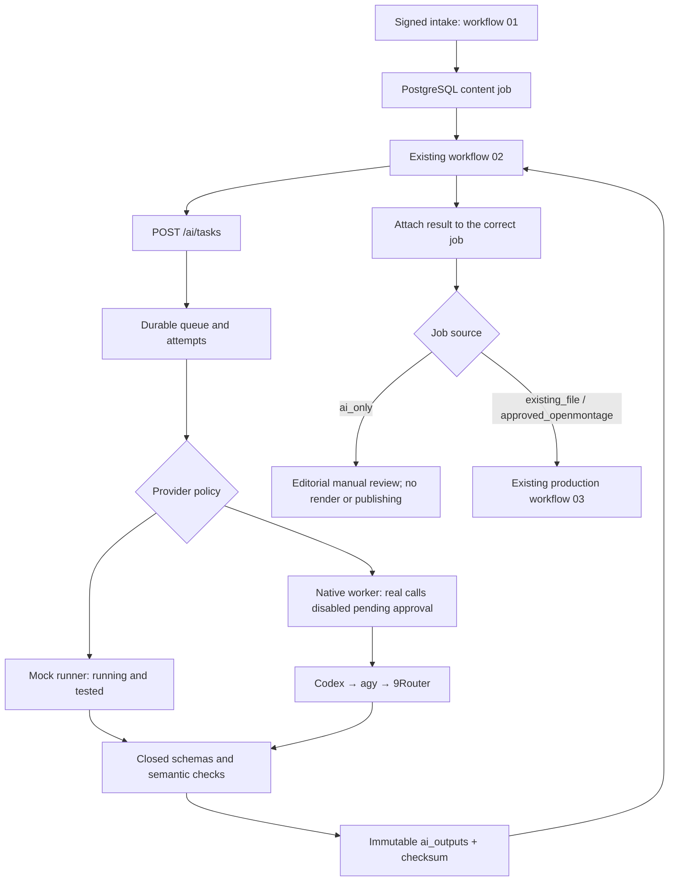

# Milestone E2 AI Brain — deployed local state

2026-10-31: the durable manager and asynchronous n8n integration are running. **Real inference has not been authorised or executed. E2 is not accepted.** Advanced supervisor work remains deferred. The completed Horror MP4 has not been regenerated or published.

The existing Studio API, PostgreSQL and n8n were extended in place. No dependencies, images or models were installed; no credentials were created or changed. The owner file `implementationsoofar.md` is preserved unmodified and uncommitted.

## Provider evidence and the activation boundary

| Provider | Actually verified | Current unattended status |
| --- | --- | --- |
| Codex 0.165.0 | Installed launcher; clean-home `--version` and `exec --help`; JSONL, schema, ephemeral and read-only flags | Adapter protocol implemented; no verified external isolation executor or scoped model-auth grant. Skipped as unsupported for this unattended runtime. No model request/authentication attempt. |
| Antigravity `agy` | Actual standalone executable; `--help` confirms print mode, JSON/stream JSON, JSON schema, timeout, plan and sandbox options | Independent automation is supported by the installed CLI; safe filesystem/tool isolation and authorised cached-auth usage are unverified. Adapter protocol implemented, default executor absent. No model request/authentication attempt. |
| Existing 9Router 0.5.112 | Existing process, port 20128, unauthenticated loopback `/v1/models` HTTP 200 and thirteen listed model IDs | HTTP adapter implemented; route permission, no-charge tariff and upstream/fallback behaviour require confirmation. No inference. `/health` returns 404, so it is not used as a readiness probe. |

The fixed production preference remains **Codex → agy → 9Router**. Fixture fallback and real endpoint discovery are distinct. There is no evidence of live Codex→agy→9Router model fallback. CLI availability does not prove safe isolation: a working directory, read-only flags, clean environment or a plan mode alone do not establish the required OS boundary. The built-in native worker therefore cannot launch either agent CLI. This is a pending runtime limitation, not a claim that `agy` is merely an IDE launcher.

Codex's documented automation surface includes JSONL and `--output-schema`; saved authentication is sensitive. See [official noninteractive documentation](https://learn.chatgpt.com/docs/non-interactive-mode) and [configuration reference](https://learn.chatgpt.com/docs/config-file/config-reference). Antigravity documents headless JSON/schema output and cached-auth behaviour in its [official headless guide](https://antigravity.google/docs/cli/headless/). Installed help was inspected independently of these documents.

9Router currently listens on `0.0.0.0:20128`. No host setting was changed. Social Studio calls loopback only. The model list is neither quota nor pricing evidence; a model name containing `free` does not authorise usage. No provider account store, tokens, cookies, saved CLI authentication, or router credential database was inspected.

## Implemented path



Workflow 02 preserves the legacy synchronous mock request, adds configurable v2 requests, polls with a Wait node, handles terminal failures through the existing local notification workflow, and stops AI-only jobs before production. Provider fallback is inside the manager, not in provider-specific n8n workflows. Existing-file/approved-project requests may supply a validated `production_settings.ai_request`; absent that setting, the historical mock title path remains intact.

## Contracts and persistence

Authenticated endpoints: `POST /ai/tasks`, `GET /ai/tasks/{id}`, `POST /ai/tasks/{id}/cancel`, `GET /ai/tasks/{id}/history`, `GET /ai/providers/health`, `GET /ai/providers/status`. The existing public `/health` remains a non-secret service readiness check. Existing control/n8n/worker roles are retained; typed `/ai/worker/...` operations cannot accept commands, paths, URLs or execution flags.

V2 requests use `social-studio.ai.v2` and require `content_job_id`, `brand_id`, `task_type`, `input`, `idempotency_key`, `provider_policy`, `maximum_cost`, `timeout_ms`, `retry_policy` and `output_schema_version`. Optional `task_id` and `content_version` are checked. Eight closed schemas cover the seven requested task types plus `content_package`, which combines the first acceptance outputs in one request. JSON schema files are exported in `services/ai-agent-manager/schemas/`.

Migration 002 extends the existing `ai_tasks` without dropping rows, adds `ai_task_attempts`, `ai_provider_health`, and immutable `ai_outputs`, and permits editorial-only content jobs. Composite foreign keys enforce brand ownership. A partial unique index permits only one active AI attempt across mock/native runners. Row locks and idempotency checks prevent duplicate execution. Output checksums bind versioned results; attaching a result increments the content version, preserving existing publishing-approval invalidation.

Actual/estimated/reserved costs are separate. Missing usage and actual price remain null. All current provider execution evidence is simulated and has known zero test cost. A reservation is not proof of billing. Model errors are stored as categories, never raw stderr/headers/provider diagnostics. Common credential-shaped input/output is rejected before persistence; this is a guard, not a general secret detector.

## Failure, cancellation and resources

Bounded attempts, exponential backoff, task deadlines (maximum five minutes; the proposed canary uses two), leases and heartbeat support recovery. Unsupported/unavailable providers and eligible transient failures can advance to the next configured provider. Authorization, credential-policy violations, unsafe requests, cancellation, exhausted budget and uncertain side effects cannot advance. Lost live-policy leases go to manual review because execution/cost may be unknown; no blind re-execution. AI preparation failures put queued content into manual review.

Concurrency is one. Inputs are at most 20,000 UTF-8 bytes; validated output at most 128 KiB; HTTP provider response at most 256 KiB; the existing API request cap is 256 KiB. Provider errors/logs are categorised and bounded. Native text-only requests use no local model/GPU; no VRAM measurements or performance claims are made. Existing Docker memory limits remain in force; the proposed native worker command caps V8 heap at 128 MiB, not total Windows process RAM. No Windows services/startup/security settings were changed.

## OpenMontage boundary

The mapper emits draft script/scene-plan artifacts matching the actual pinned upstream schemas, narration, scene timing, visual directions, search terms and brand settings. Both upstream schemas were validated with the existing Python/jsonschema environment. The mapper does not acquire footage, invoke tools, create checkpoints, approve stages, render, or publish. Future production must still use OpenMontage's pipeline/director/approval workflow. No AGPL implementation code was copied; review commercial deployment obligations separately.

## Actual evidence

Latest mock canary: run `3a5a058b-4664-4130-8071-7e259cc0ca5d`, job `3ff5a006-6bac-49de-a633-8eac218bbea6`, task `18cb1a4c-ac62-4d57-9d97-ca83e0989ce3`. [Receipt](test-evidence/milestone-e2/3a5a058b-4664-4130-8071-7e259cc0ca5d/canary.json). Measured host elapsed time: **1.580 s**, with simulated failure then simulated success, not live inference latency.

Artifacts: `C:\Projects\Manas_Flow\SocialStudio\brands\horror\projects\ai-3ff5a006-6bac-49de-a633-8eac218bbea6\`. They are deterministic fixtures, not AI-generated production content. Generated drafts and runtime policy files remain outside Git. The first canary also passed in 2.340 s; its evidence is retained.

Local tests: 88/88. Actual PostgreSQL tests: 24/24 (rollback fixtures). Actual AI API permission checks: 11/11. Existing API checks: 13/13. The original existing-video mock acceptance was rechecked successfully without another video or post. Historical Milestone A test counts remain separate. [Final artifact scan](test-evidence/milestone-e2/2026-10-31T13-05-33-501Z/artifact-safety.json): 99 changed files, zero plaintext local-key hits; original pilot, setup/access packets and proxy/override digests unchanged.

## Reproduction and operator actions

Already installed tooling only, from the project root:

```powershell
node scripts/discover-ai-providers.mjs
node scripts/test-ai-brain.mjs
node scripts/test-ai-deployed.mjs
node scripts/ai-brain-canary.mjs
node scripts/verify-ai-artifacts.mjs <completed-canary-job-uuid>
node scripts/record-ai-deployment.mjs <completed-canary-run-uuid>
```

Discovery uses an empty CLI home and unauthenticated loopback metadata requests; it makes no inference calls. The deployed tests require the existing approved local auth grant and access to the Docker pipe; no credentials are printed. Tests may create labelled application fixtures/replay receipts; SQL lifecycle fixtures roll back. Evidence is timestamped and older receipts are preserved.

`node scripts/activate-ai-brain-local.mjs --local-mock-only` is the repeatable additive migration/import operation. It verifies migration checksums, applies 002 only once, imports/publishes **only workflow 02**, and restarts existing API/n8n services. `--refresh-api-only` avoids reimporting n8n when only server code changes. This is local deployment, not permission to connect model accounts.

After a separately approved real canary, export its result using the same canary script and verify schemas. Real operation requires the digest-bound [approval packet](AI_BRAIN_CANARY_APPROVAL.md). An unsupported CLI requires an independently reviewed isolated executor before activation; no new supervisor implementation was started.

Rollback is non-destructive: stop only an identified foreground AI canary worker; restore the prior workflow 02 export and service code from the previous Git commit using a reviewed patch, then restart those two services. Leave additive tables/rows and migration history intact; do not down-migrate or reset databases. No volumes, credentials, original media, other containers or Windows settings are removed. Treat a worker/HTTP request with unknown outcome as manual review, not permission to retry it.

Remaining work: confirm an authorised zero-charge 9Router route, obtain the bounded canary grant, execute real inference through n8n, validate/persist/export actual model output, and separately implement/verify eligible CLI isolation if Codex/agy must execute. No unattended production grant is implied by a one-call test.
