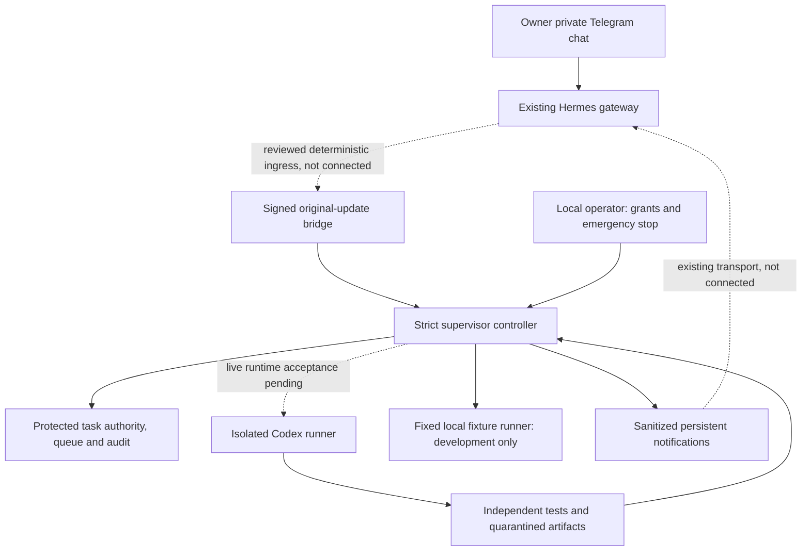
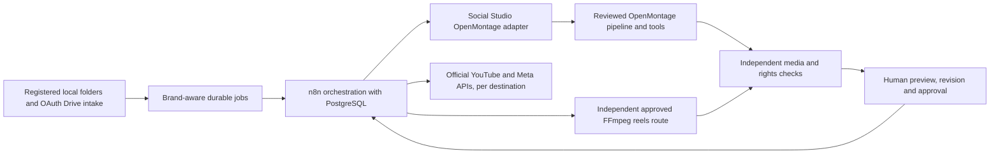

# Social Studio architecture

Current priority: **Milestone E local orchestration**, following the real completed Horror pilot. [The orchestration architecture](ORCHESTRATOR_ARCHITECTURE.md) and [operations runbook](ORCHESTRATOR_OPERATIONS.md) describe the prepared n8n/PostgreSQL/adapter implementation, which is not yet deployed or accepted. Both E installation and fresh-local-auth grants remain pending. Advanced A hardening is deferred; the historical supervisor architecture below remains preserved and live-disabled. Existing OpenMontage/FFmpeg/Piper installations and the finished video are reused; no social credentials or live publishing have been enabled.

`src/supervisor/` currently implements the controller, strict contracts, journal, Telegram parsing, signed bridge boundary, fixed fixture process runner, safe Codex invocation construction and bounded Codex JSONL telemetry parsing. No network listener or Telegram poller is started. The bridge is an IPC contract proposal, not a deployed Hermes plugin. `CodexRunner.start()` fails closed because live runtime/credential/isolation acceptance is not provisioned.

The controller starts paused on every open. Task and grant snapshots are immutable in memory; task/policy/test/runner digests must match before enqueue and again before dispatch. A one-use grant is consumed by queueing. Telegram cannot mint grants, choose an executable/path/model/flags or expand a task. State is journaled/fsynced before dispatch; an interrupted launch never auto-resumes.

A-03 now adds a read-only pinned disk authority store, disjoint registered roots/project baselines and a persisted deployment binding. It revalidates the snapshot at ingress, dispatch and final validation; grant revocation/consumption survives restart. Its code and fixture evidence are complete for this local slice, but actual operator-controlled bootstrap/ACL deployment is pending. See [the authority-store review](AUTHORITY_STORE.md); the example contains no task or grant and cannot activate dispatch.

Queue/audit uses a bounded append-only JSONL journal with sequence/hash validation, a single-controller lock and retained failure evidence. This detects corruption but is not protection against a local administrator. Actual deployed authority/state must be outside worker-writable storage under independently verified OS controls; the local development directories do not establish those controls.

The fixture worker is fixed reviewed Node code, runs with a minimal environment and Node filesystem permissions, and cannot spawn descendants through Node's permission model. This is adequate to exercise local lifecycle code, not evidence of general Windows process-tree, network, memory or identity isolation for arbitrary Codex/media tools. No live runner can be enabled through `enableLocalFixtures()`.

Future production architecture (outside the expressly authorized local pilot):

Keep OpenMontage stage-director/pipeline/approval flow intact. All scheduling/publishing belongs to n8n; no engine receives social credentials or silently runs a publish stage. Brand/destination mappings and final artifact hashes bind approvals. The requested seven-operation production API, brands, ingestion, database and platform integrations are planned, not implemented.
