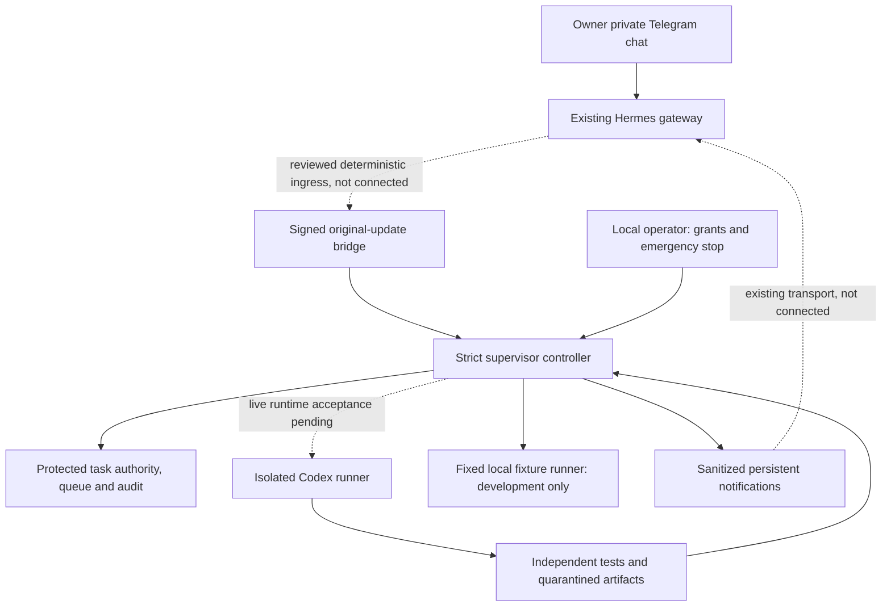
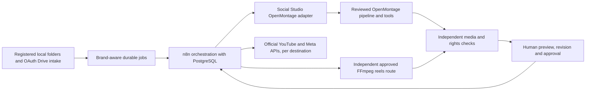

# Social Studio architecture

**E3 verified addition:** signed n8n topic intake now resolves the brand profile and creates a bounded `production_package` AI task. Workflow 02 persists the validated concept/script/storyboard/metadata; workflow 03 dispatches the same job to the existing native worker, which selects licensed local assets or original component fallback, measures Piper phrase audio, burns captions and calls OpenMontage composition/review. Actual QC, operator/test approval, scheduling and three mock adapters remain in the original workflows/PostgreSQL. Three Horror end-to-end runs and an ordinary Travel render passed. Existing-file and fixed-template paths remain separate. [Current status/limitations](E3_DYNAMIC_VIDEO.md). Real inference stays blocked; no new container, polling bot, account, public endpoint or privileged supervisor.

**Generated-video bridge verified, 2026-10-31:** existing n8n workflows 01→02 (supplied-script fixture)→03 now dispatch an `approved_openmontage` generation job to the single authenticated Windows worker. A fixed, project/digest/expiry-bound offline template authors original moving scene/audio assets and calls the installed OpenMontage registry for Piper, mixing and final composition. Workflow 04 validates the actual new output, then checksum-bound mock approval→scheduling→three mock platform adapters→durable results/notifications/reporting complete. Existing-file mode remains separate and unchanged. [Actual acceptance and limitations](GENERATED_VIDEO_ACCEPTANCE.md). No new containers, external providers, credentials or live publishing; real AI route clearance remains pending.

**Current E2 addition (2026-10-31):** the existing Studio API contains a durable AI manager, migration 002 adds attempts/immutable outputs/provider capability state, and workflow 02 now polls one provider-independent AI interface. Six brand profiles and eight schemas feed a draft OpenMontage mapper. Actual n8n/PG mock acceptance and restart persistence pass; real inference is blocked on route permission/cost and CLI isolation. No extra containers, models, account credentials, render or publishing. [AI architecture and operator guide](AI_BRAIN.md), [verification matrix](AI_BRAIN_TEST_MATRIX.md). Codex → agy → 9Router priority is preserved; A remains deferred.

Current result: **Milestone E existing-video MVP automated acceptance passed** after all three explicit E grants. Four services healthy; fixed proxy provides only loopback access, while n8n/application/PostgreSQL retain internal-only networking. Twelve workflows actually imported/published/executed; twenty deployed regression scenarios passed. [Orchestration architecture](ORCHESTRATOR_ARCHITECTURE.md), [operations](ORCHESTRATOR_OPERATIONS.md) and [actual evidence](TEST_RESULTS.md) identify remaining stages. Advanced A stays preserved/deferred/live-disabled. No new render, social account connection or live publishing enabled.

`src/supervisor/` currently implements the controller, strict contracts, journal, Telegram parsing, signed bridge boundary, fixed fixture process runner, safe Codex invocation construction and bounded Codex JSONL telemetry parsing. No network listener or Telegram poller is started. The bridge is an IPC contract proposal, not a deployed Hermes plugin. `CodexRunner.start()` fails closed because live runtime/credential/isolation acceptance is not provisioned.

The controller starts paused on every open. Task and grant snapshots are immutable in memory; task/policy/test/runner digests must match before enqueue and again before dispatch. A one-use grant is consumed by queueing. Telegram cannot mint grants, choose an executable/path/model/flags or expand a task. State is journaled/fsynced before dispatch; an interrupted launch never auto-resumes.

A-03 now adds a read-only pinned disk authority store, disjoint registered roots/project baselines and a persisted deployment binding. It revalidates the snapshot at ingress, dispatch and final validation; grant revocation/consumption survives restart. Its code and fixture evidence are complete for this local slice, but actual operator-controlled bootstrap/ACL deployment is pending. See [the authority-store review](AUTHORITY_STORE.md); the example contains no task or grant and cannot activate dispatch.

Queue/audit uses a bounded append-only JSONL journal with sequence/hash validation, a single-controller lock and retained failure evidence. This detects corruption but is not protection against a local administrator. Actual deployed authority/state must be outside worker-writable storage under independently verified OS controls; the local development directories do not establish those controls.

The fixture worker is fixed reviewed Node code, runs with a minimal environment and Node filesystem permissions, and cannot spawn descendants through Node's permission model. This is adequate to exercise local lifecycle code, not evidence of general Windows process-tree, network, memory or identity isolation for arbitrary Codex/media tools. No live runner can be enabled through `enableLocalFixtures()`.

Future production architecture (outside the expressly authorized local pilot):

Keep OpenMontage stage-director/pipeline/approval flow intact. All scheduling/publishing belongs to n8n; no engine receives social credentials or silently runs a publish stage. Brand/destination mappings and final artifact hashes bind approvals. The requested seven-operation production API, brands, ingestion, database and platform integrations are planned, not implemented.
