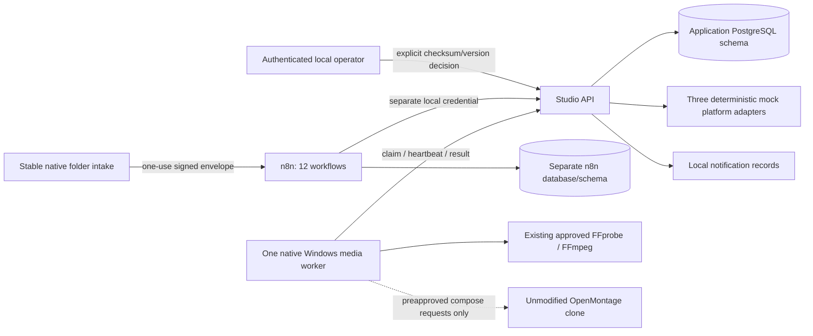

# Milestone E implementation and acceptance boundary

Status: all three E grants executed. **Existing-video automated MVP acceptance passed** against actual n8n/PostgreSQL: twelve successful workflow IDs, twenty deployed regression scenarios, native worker and four healthy services. Fixed proxy alone joins frontend/internal networks and publishes 127.0.0.1:5678/8780; n8n/application/PostgreSQL stay internal with no default gateway. Existing Horror MP4 unchanged; supervisor deferred; no Telegram/social/model account use. Remaining new-render/official upload/backup/retention stages are not claimed complete.

The application service shares one dependency lock/runtime but has separate modules under production-adapter, publishing-adapter and ai-agent-manager. n8n controls transitions between intake, metadata, production, QC, approval, scheduling, platform dispatch, notification, recovery and reporting. PostgreSQL holds durable jobs/approvals/leases/results; n8n Wait nodes persist the orchestration waits. Generation receives no publishing credentials. Publishing has no native command interface. Codex is the development agent only.

The API container cannot execute Windows encoders. An outbound-only native worker claims fixed operations from the loopback API, invokes known tools without a shell and reports real exit codes, hashes and bounded logs. Existing-file validation runs before human approval and fresh file verification runs before mock publication. PostgreSQL transaction locks/SKIP LOCKED implement claiming; one native task at once protects the laptop. Worker cancellation uses tracked PID/tree termination. Unverified cleanup stops the worker. This is a constrained local media worker, **not proof of the unfinished Milestone A Windows OS sandbox**.

The only Docker host ports bind 127.0.0.1. PostgreSQL stays internal. The internal bridge has no planned Internet egress; no Docker socket, host-home mount, social/AI credentials or browser automation. Media/brand/service mounts are read-only. Separate databases and non-superuser roles isolate n8n internals from the application; composite foreign keys prevent cross-brand media, approval and destination references. Operator/n8n roles are trusted across all configured brands, so this is not a multi-tenant user-access system or PostgreSQL row-level security deployment.

Existing files require a SHA256 at intake, making deduplication stable under file rename for the same brand. Repeated idempotency keys with changed request bodies fail. Approval binds the current content version and video checksum, expires after 24 hours, and requires an authenticated operator decision. n8n/worker credentials cannot approve. Changed media/version invalidates approval through SQL triggers when detected; pre-dispatch verification checks actual bytes. Publishing mode is constrained to mock in code and SQL. Platform IDs are deterministic and receipts persist by idempotency key. Unknown outcomes require reconciliation/manual review.

The current single mock destination per selected platform/brand is sufficient for the pilot. The schema allows multiple independent accounts, but selecting among multiple destinations on one platform needs an explicit destination-ID contract before live integration; ambiguous mapping fails closed. No credential sharing or implicit cross-brand routing is permitted.

OpenMontage generation is a narrow compose-stage bridge for an independently reviewed, digest/expiry-approved local project with completed assets/edit checkpoints and a new output path. It uses the existing tool registry/FFmpeg runtime rather than a replacement engine. Raw topic-to-video planning, asset discovery, model downloads and upstream publishing remain outside this unattended bridge. No new render was tested in E. Existing FFmpeg long-form workflows remain separate; no viral-highlight capability is claimed.

The six AI task types have structured mock outputs and deterministic failure/fallback. Nonzero cost and unknown providers are rejected. A disabled 9Router-compatible request contract establishes an interface only; it does not authenticate, route subscriptions or run an external model.

Identical AI requests lock their job and reuse persisted results; repeated metadata application does not increment the version again. The scheduler discovers durable approved jobs independently of a particular n8n Wait execution, so approval after an n8n restart still schedules exactly once. The deployed restart test verifies this business-state recovery, not preservation of the same interrupted n8n execution ID. Test fixture jobs carry acceptance_run_id and are currently included in report aggregates; production analytics filtering is a remaining refinement.

OpenMontage's AGPL obligations require review before modifying/distributing it or offering a client service. No upstream source was copied into these adapters or altered. Process separation alone is not a legal exemption. n8n's [pinned licence](https://github.com/n8n-io/n8n/blob/n8n%402.45.7/LICENSE.md) permits specified internal/personal uses and has commercial/distribution limits; review any customer-facing hosting/resale separately. No commercial compliance sign-off is asserted.

Remaining deployed acceptance includes SQL constraints/permissions, restart persistence, actual n8n import/type compatibility, interrupted Wait recovery, worker-service outages, file-change invalidation before dispatch, explicit rejection/expiry, replay receipt uniqueness, publication retries/reconciliation and backup restore. A static export or mock-function pass cannot accept these items.
