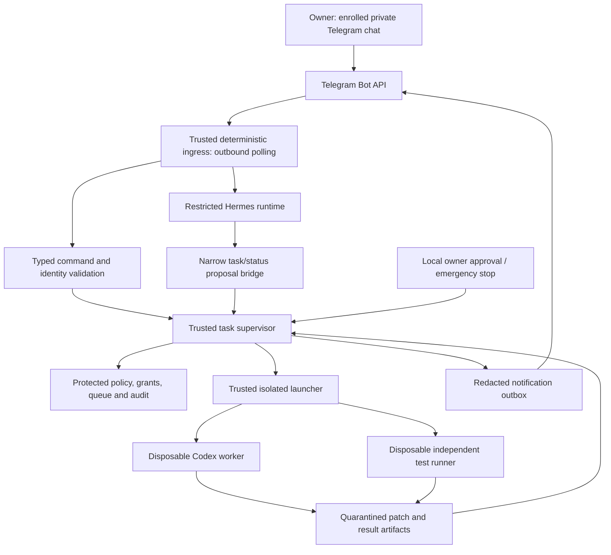

# Restricted remote development design

Status: **proposed design, not implemented or enabled**. Reviewed against official documentation on 2026-10-28. Foundation approval is required before implementation; separate operational grants are listed in [HUMAN_ACTIONS.md](HUMAN_ACTIONS.md).

## 1. Architecture and trust boundaries

The supervisor is a deterministic program owned by the operator. Hermes interprets requests and summarizes status; Codex edits a job workspace. Neither model is an authorization authority.



The ingress is the reviewed, deterministic transport portion of the Hermes Telegram integration or a small adapter in front of it. It authenticates original updates **before** model handling. Its exact extension point must be verified against the pinned Hermes version. Do not run a second `getUpdates` consumer using the same bot token. If Hermes cannot expose a safe integration point or disable dangerous built-ins, keep execution disabled and propose an adapter change for review.

Separate protection domains:

| Component | Allowed access | Denied access |
| --- | --- | --- |
| Ingress/notifier | Bot credential, original Telegram metadata, private destination, narrow supervisor IPC | Job shell, host project writes, approval-store writes |
| Hermes model/tool runtime | Sanitized request context and narrow bridge | Bot/provider long-lived secrets, shell, general filesystem, browser, arbitrary HTTP/MCP, package tools, cron, delegated agents, approval grants |
| Supervisor and launcher | Protected policy/ledger, immutable accepted baselines, approved runtime control | Arbitrary commands from the model or Telegram; self-updating deployments |
| Codex worker | One job workspace, fixed tools, job-scoped model broker capability | Owner home/auth, supervisor state, host drives, Docker socket, public publishing credentials |
| Test runner | Candidate snapshot, fixed reviewed test profile, disposable scratch | Provider/bot credentials, policy writes, unrestricted network |
| Local operator | Review, grant/revoke, deploy accepted versions, emergency stop | No model can impersonate this role |

Enforce the table with distinct identities/containers and OS/network controls, not directory names. Sharing the owner's Windows account or one writable home defeats the boundary. WSL access to Windows drives and interoperability must be excluded from agent runtimes; approving WSL startup alone does not approve changing its configuration. Only the launcher may hold engine authority, never an agent or test container. Do not expose a Docker socket, privileged container, broad bind mount, or host namespace.

## 2. Threat model and fail-closed requirements

Protect the owner's files and credentials, repository integrity, control policy, approval ledger, execution budget, and audit evidence. Assume Telegram text, model responses, dependencies, repository instructions, and tests can contain malicious instructions or code. Account compromise, bot-token theft, command injection, forged approvals, filesystem escapes, stale messages, outages and orphaned jobs are relevant threats.

- **Identity/replay:** Validate the exact numeric sender and private chat, original update metadata, allowed update type, bounded timestamp and deduplication key. Never trust identity fields generated by Hermes.
- **Privilege escalation:** Keep deployments, grants and command/test registries immutable to workers. A patch cannot change active permissions. Fail startup if the configured isolation cannot be verified.
- **Filesystem/process escape:** Use disposable runtimes, fixed working roots, canonical path validation and process-tree limits. Reject symlinks, junctions/reparse points, hard-link aliasing, traversal, UNC/device paths, alternate data streams and case-insensitive path escapes at ingestion/export. Use handle-based/no-follow validation to avoid check/use races. Reject Git hooks/config/submodule changes and metadata paths in generated artifacts.
- **Network/secret leakage:** Workers and tests have no general Internet/LAN/host/metadata access. Use a narrowly routed model broker; enforce restrictions below shell environment variables. Keep long-lived credentials outside all untrusted execution.
- **Resource abuse:** Enforce finite time, attempts, disk/log size, processes/memory, model calls and aggregate spend. Fail closed on an unavailable ledger, insufficient reservation, or unknown usage.
- **False success:** Treat Codex output as untrusted. A trusted runner records actual exit codes, tests, diff checks and artifacts before a task can succeed.

`AGENTS.md`, prompts, command-prefix lists and `--sandbox workspace-write` are defense in depth. None is a substitute for isolating arbitrary code executed by Codex or tests. A post-run changed-path check detects a violation but cannot undo data already leaked; OS controls must prevent it during execution.

## 3. Immutable task and approval records

Use strict schemas (`additionalProperties: false`), bounded fields and server-generated IDs. Proposals in the repository are not executable authority. A task definition includes:

| Field | Meaning |
| --- | --- |
| `id`, `revision`, `manifest_sha256` | Immutable task identity and canonical content digest |
| `repo_id`, `baseline_sha`, `input_snapshot_sha256` | Registered repository, accepted commit and exact source snapshot; never an arbitrary path/URL |
| `objective`, `acceptance_criteria` | Reviewed bounded instructions; no raw executable field |
| `depends_on` | Exact predecessor revisions/results; cycles and unmet dependencies rejected |
| `allowed_paths`, `protected_paths` | Permitted edits and explicit deny rules; supervisor policy can only narrow these |
| `test_profile_id`, `test_profile_sha256` | Fixed reviewed command vectors and validation harness; worker cannot replace them |
| `runtime_digest`, `codex_version`, `model_id` | Reviewed executable/image/model selection |
| `limits` | Attempt/time/process/memory/disk/log/request/token and money limits |
| `approval_id`, `expires_at` | Reference to a matching unrevoked owner grant; not a boolean the model can set |

An approval record includes owner identity, local verification method, action class, task/backlog/policy/test/runtime digests, baseline scope, limits/currency, issued/expiry times, nonce and revocation status. Store it with operator-only write access. A batch grant binds an ordered backlog revision and any permitted predecessor-output linkage; subsequent outputs are eligible only after validation. Protected changes require explicit acceptance and a fresh baseline/grant.

Backlog documents initially have `proposed` status. The local operator reviews exact manifests and creates grants through a separate protected interface. Models may create proposals, never grants. Short-lived job capabilities bind the task, principal, policy digest and expiry; they cannot be exchanged for broader permissions.

Start with `enabled = false`, no grants, no live provider access and zero authorized spend. Proposed ceilings, subject to owner approval: one active job, 20 minutes per attempt, two attempts per task including one repair, three tasks/60 minutes per batch, 30-second controller heartbeat, and a 5-minute stale-command window. Heartbeat measures process/controller health, not model progress. Stop after five minutes with no runner/event activity unless the approved test profile declares a bounded quiet phase. Money limits remain unset/disabled until explicitly approved.

## 4. Supervisor lifecycle and continuation

```text
proposed -> awaiting_approval -> queued -> preparing -> running -> testing
testing -> succeeded | repair_queued | failed | needs_approval
active states -> cancel_requested -> cancelled
active states -> timed_out | interrupted | needs_approval
```

`rejected` is terminal for invalid or unauthorized requests. `repair_queued` can re-enter preparation only within the original scope, retry count, time and budget. The batch has a separate `paused`/`enabled` dispatch latch. Pause stops the next dispatch; cancellation stops the current worker too.

Dispatch algorithm:

1. Acquire a single-instance/queue lease and durable transaction. Check the local stop latch, owner/grant/revocation, task and policy digests, dependency results, resource/budget reservations, and runtime readiness. Reject a dirty/changed accepted baseline; preserve user work.
2. Persist a job/attempt ID and intended launch record before spawning. Create an isolated workspace from an immutable reviewed snapshot. Since this repository has no commits, do not create jobs until GIT-01 supplies a baseline. Keep owner Git metadata outside the worker. A private job-local Git repository may be created by the trusted launcher with reviewed config and no hooks/remote credentials.
3. Launch the fixed Codex vector with sanitized environment and stdin prompt. Record PID/container ID, process start identity, sandbox/runtime version and heartbeat. The worker cannot choose launcher flags or add permissions.
4. Parse bounded JSONL events; track progress, usage and failures. Kill the full process/container tree on cancel, expiry, policy violation, resource limit or timeout. Verify termination before releasing the lock/reservation or starting another job.
5. Quarantine all output. Validate file types/paths, protected paths, diff/size limits, manifest/result schemas and secret scanning. Export regular files/patches through a trusted copier; never execute generated artifacts on the host.
6. Freeze/hash the candidate snapshot and run the trusted validation profile in a fresh sandbox. Record command vectors, environment profile, exit codes, test counts and output hashes. Detect changed/removed tests. A task may add tests, but it cannot substitute the approved harness or remove required checks to pass.
7. Mark success only when process/result/evidence validation and all mandatory checks pass. Produce a local report and sanitized notification. Ordinary candidate code remains a patch; no owner-checkout merge or push occurs automatically. Failure allows at most the preapproved repair attempt using the same scope and budgets; security/policy/credential failures never trigger an automatic repair.
8. Select the next item only in the same approved backlog, with dependencies satisfied, no unresolved approval or protected diff, an unchanged effective policy, and all batch limits intact. Otherwise persist the stop reason and await intervention. No invented task or unbounded "keep improving" loop.

Persist transitions in SQLite (available built-in runtime support must be verified) or a versioned transactional append journal with durable snapshots. Do not install a storage package implicitly. Journal writes, outbox entries and queue updates must be crash-consistent. Use a controller-only append audit with hashes; a hash chain detects some corruption but is not tamper-proof against the local administrator. Worker logs cannot edit audit history.

On restart: start paused; acquire the exclusive lease; validate journal/snapshot integrity; reconcile launcher IDs and kill/quarantine orphaned workers; mark unresolved attempts interrupted. Do not automatically replay launch records, retry unknown outcomes, or resume `--last` sessions. The owner confirms recovery before dispatch resumes. An unavailable audit store or unconfirmed kill blocks new work.

## 5. Codex launch and test controls

Official Codex documentation provides noninteractive `codex exec`, JSONL progress via `--json`, and final-output schemas. Use a pinned version and verify its `--help` and effective configuration during approved setup. The following is a **conceptual argument vector**, not an installation or command to run now:

```json
[
  "<approved-absolute-codex-executable>",
  "--ask-for-approval", "never",
  "exec",
  "--sandbox", "workspace-write",
  "--json",
  "--cd", "<isolated-job-workspace>",
  "--output-schema", "<read-only-result-schema>",
  "--output-last-message", "<job-output-path>",
  "-"
]
```

Spawn the executable directly with an argument array and shell disabled. If the installation provides a script shim, resolve/review the underlying executable or fixed Node script; never concatenate shell input. Use a generated prompt on stdin. `--ask-for-approval never` means the child cannot solicit/escalate permissions; **it does not approve restricted operations**. The external supervisor stops and requests a local grant when scope is insufficient. Keep the sandbox active; never retry using full access or automatic review. See [Codex approvals](https://learn.chatgpt.com/docs/agent-approvals-security) and [CLI reference](https://learn.chatgpt.com/docs/developer-commands?surface=cli).

Use a dedicated controlled Codex home/config and sanitize inherited configuration, hooks, rules, skills, MCPs, plugins, provider endpoints and environment variables. Project configuration cannot loosen active policy. Validate the effective configuration and reject unknown/unsupported settings; do not copy the owner's `.codex`. No live search, arbitrary MCP, credential import, package fetching, detached services, or shared-session reuse. Permit only a named model/provider under its grant. An isolated job may contain a private Git repository, but no host `.git` access or remotes.

Codex can invoke scripts inside its sandbox, so a top-level launcher allowlist alone does not restrict everything those scripts do. The independent test registry similarly maps profile IDs to fixed executable/argument vectors and exact reviewed harness hashes; package scripts and tests remain untrusted and stay sandboxed. Installation hooks and dependency restores are not test steps. If prerequisites are missing, stop for an installation grant.

The credential broker is a required implementation proof: hold long-lived model keys outside Hermes/Codex/test runtimes and expose only job-scoped inference capabilities on a narrowly isolated endpoint. Restrict routes, model, requests, tokens and concurrency. No arbitrary proxy destinations. Verify that the pinned CLI/provider can use this broker without exposing a long-lived key to shell tools. If it cannot, keep live execution disabled and present an alternative for owner approval. Do not put a real API key in an environment inherited by untrusted commands.

Reserve worst-case bounded request cost before forwarding each inference call; account for Hermes and Codex together. Provider limits/quotas are an additional backstop. Completed-event token totals support reporting but are not a hard spend cap, and killing a local process does not necessarily cancel remote billing. Include in-flight reservations in the authorized ceiling. If enforceable cost bounds cannot be established, do not start a paid batch.

The current Windows sandbox documentation describes multiple implementations with differing setup and isolation requirements. Availability on this machine is unverified. Native/WSL selection and sandbox provisioning require validation and any necessary owner grants; do not silently choose a weaker fallback. See [Windows sandbox](https://learn.chatgpt.com/docs/windows/windows-sandbox).

## 6. Hermes and Telegram integration

Hermes documents native Windows and Linux/WSL installation routes. Its installer may fetch multiple managed runtimes and optional tools; installation must use a reviewed pinned artifact/commit and an explicit dependency inventory. Do not pipe a remote installer directly into a shell, import another agent's setup, accept default tool bundles, enable auto-update, or run an interactive setup that purchases/connects services implicitly. See [Hermes installation](https://hermes-agent.nousresearch.com/docs/getting-started/installation).

Use the Telegram gateway's outbound long polling for the private pilot. Hermes documents this as its default; Telegram polling and webhooks are mutually exclusive. No public port, tunnel, domain or inbound firewall rule is needed. Check any existing webhook state before approved activation; removing it is a configuration change needing scope. See [Hermes Telegram setup](https://hermes-agent.nousresearch.com/docs/user-guide/messaging/telegram) and [Telegram Bot API](https://core.telegram.org/bots/api).

Hermes's documented user allowlists are useful defense in depth. Independently enforce sender **and private chat** in deterministic code, deny groups/channels/anonymous senders and bot messages, and leave wildcard/open-user access disabled. Hermes admin/slash-command roles do not themselves restrict plain-chat tool use. Review and disable all built-in command/tool escape routes; an unverified toggle is not an isolation boundary. See [Hermes messaging security](https://hermes-agent.nousresearch.com/docs/user-guide/messaging).

The narrow bridge exposes only structured operations such as `list_approved_tasks`, `get_job_status`, `propose_task`, and `request_start(task_id, revision)`. Pause/cancel route directly to the deterministic controller. It has no `exec`, arbitrary path, URL, environment, approval-grant, install, publish or policy-edit operation. Bind requests to a short-lived ingress context referencing the persisted original update; the model cannot supply or modify sender/role fields. The ingress authentication/signing key is inaccessible to the model/worker. An unverifiable identity context cannot authorize a start.

Proposed operator commands (custom adapter commands, **not claims about built-in Hermes commands**):

| Command | Effect |
| --- | --- |
| `/studio_status [job-id]` | Sanitized state, last activity and remaining authorized limits |
| `/studio_queue` | Exact approved backlog revision and pending items |
| `/studio_run TASK-ID REVISION` | Start one already approved task after deterministic validation |
| `/studio_continue BATCH-ID` | Resume an existing finite batch after revalidation; cannot approve new tasks |
| `/studio_pause` | Persist dispatch pause; current job may finish unless cancelled |
| `/studio_cancel JOB-ID` | Request full worker-tree termination and report verified outcome |
| `/studio_approval REQUEST-ID` | Show a redacted request; requires the local owner interface to grant |

Natural-language instructions can propose a task, never silently expand an approval. During the first release, only exact commands consume existing grants. High-risk approval grants remain local, even when requested remotely.

Persist Telegram update IDs and action idempotency keys **before** accepting work; advance the polling offset after durable ingestion. Reject edited/forwarded commands, stale execution commands, unknown update types, oversized input and attachments. Callbacks, if later added, use single-use expiring nonces tied to the owner/chat/task digest. Repeated or out-of-order delivery cannot launch twice. Offline updates never become automatic starts on boot; accept read-only status or require a fresh start command. Verify the pinned Hermes cold-start/update handling rather than assuming its defaults preserve the queue. Telegram's server-side update retention is limited, so the local journal is authoritative for task state.

Send only allowlisted status fields (task/job ID, state, elapsed time, test counts, spend summary, approval request ID) through a rate-limited durable outbox. Treat all arbitrary model/log strings as private; redact before persistence/egress and escape Telegram markup. Do not relay raw command output, code, patches, file contents, auth URLs or secrets. Telegram failure does not fail a completed job or trigger duplicate execution. A running job may finish during an outage; pause the batch before its next dispatch if the control channel is unavailable. The local stop switch always works independently.

## 7. Storage, reports, and operational rollout

Proposed logical storage (final absolute paths/ACLs require approval):

```text
protected controller deployment/     reviewed supervisor + schemas + command registry
protected controller state/          grants, task manifests, queue journal, audit, outbox
protected accepted snapshots/        immutable source/policy/test baselines
isolated job scratch/<job-id>/       disposable worker workspace and bounded logs
quarantined artifacts/<job-id>/      candidate patch, test evidence, sanitized report
```

Do not place trusted state in the Git checkout or give a worker access to an entire parent folder. Keep grants and credentials out of source control. Future `.gitignore` and export policies must exclude runtime state, secret files and job logs before they are generated. Define retention/backup quotas in the installation packet; disk pressure pauses work. Artifact cleanup requires a bounded approved deletion policy; no blanket recursive cleanup.

Each report records task/backlog/grant/policy/runtime digests; source/candidate/patch hashes; attempt and timestamps in UTC; job/process identifiers; observed exits; validated changed paths; actual checks and output hashes; token/cost reservations and settlement; final status, stop reason and next human action. Separate model narrative from controller facts. Raw event streams are bounded and private; secret-bearing fields are filtered before storage.

Roll out in order: local fake-runner tests; reviewed host/isolation provisioning; one local Codex canary; restricted Hermes with private Telegram status; one remotely started approved canary; a two-task harmless batch; crash/outage/revocation drills; owner acceptance of M4. Review and deploy controller changes locally between steps. Test the explicit negative cases in [IMPLEMENTATION_PLAN.md](IMPLEMENTATION_PLAN.md) before enabling unattended continuation.

No executable code, credentials, bot, service, installation, scheduled job or remote endpoint is created by this design document.

## 8. Future media evaluation boundary

Update 2026-10-29: the latest owner instruction permits read-only anonymous source clones of OpenMontage and MoneyPrinterTurbo before M4. That exception does not enable runtime work or weaken the worker boundaries below. The current [common video interface](VIDEO_ENGINE_ARCHITECTURE.md) keeps media execution separate from the development supervisor and all production orchestration/scheduling/publishing in n8n, backed by PostgreSQL.

The [MoneyPrinterTurbo evaluation](MONEYPRINTERTURBO_EVALUATION.md) starts only after owner acceptance of M4 and applicable evaluation grants. It uses a separate isolated evaluation workspace/runtime; a clone directory alone is not isolation. No upstream installer, agent skill, launcher, test, model downloader or publishing hook may run implicitly. Dependency, instruction, test-registry, network-policy and runtime changes remain protected proposals until operator review.

Remote development workers retain their existing network and secret restrictions. Approving media evaluation does not give Codex general Internet access. A separately reviewed generation runtime may reach only the approved LLM/TTS/stock routes, using scoped broker access where feasible; provisioning any required credentials remains an owner operation. It has no Telegram, supervisor, n8n or social-platform credentials and cannot edit the controller, accepted baselines or approval store. If a provider cannot fit the reviewed credential/isolation boundary, stop and propose an alternative for review.

Use one generation job at a time with explicit memory/VRAM/time/disk/download limits, verified process-tree cancellation and quarantined artifact export. Validate generated files and upstream JSON/paths/URLs as untrusted; redact and bound logs before storage or egress. Only identifiers and sanitized status may appear in Telegram. Scheduling and publishing are exclusively n8n operations under separate integration/credential/publishing grants; MoneyPrinterTurbo cross-posting is disabled and denied network access. FFmpeg long-form-to-reels remains a separate route behind the Studio job contract.
