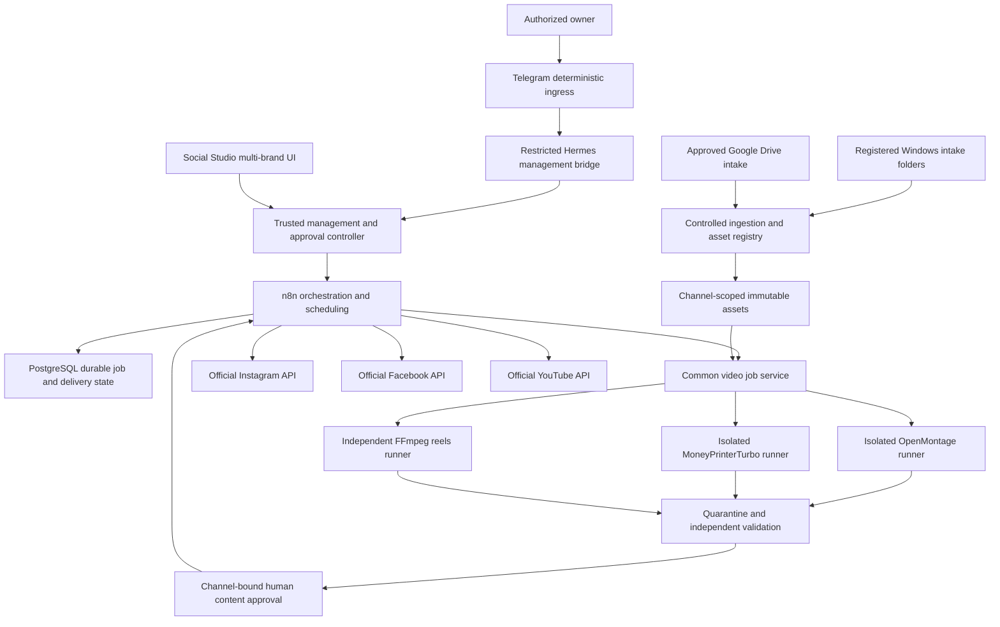

# Provider-independent video engine architecture

Status: **Phase A design only; not implemented or deployed**. Evidence and provisional engine selection are in [VIDEO_ENGINE_COMPARISON.md](VIDEO_ENGINE_COMPARISON.md). Runtime work needs the applicable [owner grants](HUMAN_ACTIONS.md); existing remote-development acceptance remains pending unless the owner explicitly accepts it or grants a bounded local-POC exception.

## Ownership and data flow



n8n owns production workflow orchestration, schedules, delivery retries and publishing. PostgreSQL owns durable state and transactional coordination; n8n execution history alone is not the authoritative job ledger. The video job service owns execution leases, engine adaptation, process isolation and artifact validation. It cannot publish. The existing development supervisor remains responsible for development jobs, not media publishing schedules.

Keep three identities separate: the management/approval controller, the untrusted generation runtime, and the publishing runtime. Generation never receives Telegram, n8n, Drive or social-platform long-lived credentials. Approved input files are staged for it. LLM/TTS/stock access uses reviewed scoped broker routes where compatible; if compatibility requires direct provider keys, stop for a separately reviewed credential/isolation design rather than widening access silently.

## Required job contract

Use strict versioned schemas, reject unknown fields and cap every field/array. A production request includes all of the following:

| Field | Required meaning |
| --- | --- |
| `schema_version`, `job_id`, `idempotency_key` | Version, globally unique job ID, stable deduplication key. Same key + different canonical request hash returns a conflict. |
| `channel_id` | Registered content channel under a brand/owner. Verify caller authorization; never infer it from prompt text or an output filename. |
| `brand_settings` | Immutable brand version/hash, palette, licensed font asset, logo asset, safe areas, title/subtitle rules, voice, language and prohibited treatments. Every referenced asset belongs to the channel or an explicitly shared collection. |
| `source_inputs` | Topic/brief, optional script, structured chart data, and registered input-asset IDs/hashes. For highlights: long-form asset, transcript if supplied, desired clip count and selection rubric. No arbitrary file paths, URLs or executable code. |
| `output_requirements` | Operation, count, duration/tolerance, dimensions, frame rate, codecs, subtitles, moving-footage rules, narration/music/graphics requirements and required sidecars. |
| `approval_rules` | Protected policy/profile references and required decision points. The effective policy is the intersection of owner, channel and request restrictions. A request cannot grant itself approval or reduce mandatory review. |
| `engine_profile_id`, `provider_profile_id`, `limits_profile_id` | Reviewed immutable executable/runtime/tool/provider/resource mappings, never arbitrary CLI flags, endpoints or environment variables. |

Illustrative content shape, **not an approved runnable job**:

```json
{
  "schema_version": "video-job/0.1",
  "job_id": "44afd30b-d12e-44b0-975e-bab0a1db1c19",
  "idempotency_key": "eval-horror-mpt-r1",
  "channel_id": "eval-horror",
  "brand_settings": {
    "brand_id": "studio-eval",
    "version": "draft-1",
    "palette": ["#121018", "#F0E8D8", "#A42B38"],
    "font_asset_id": "pending-reviewed-font",
    "voice_profile_id": "pending-reviewed-english-voice",
    "language": "en"
  },
  "source_inputs": {
    "brief": "A non-graphic lighthouse horror story with a hook in the first two seconds",
    "asset_manifest_id": "pending-rights-cleared-motion-footage"
  },
  "output_requirements": {
    "operation": "topic_to_video",
    "count": 1,
    "duration_seconds": 60,
    "width": 1080,
    "height": 1920,
    "fps": 30,
    "video_codec": "h264",
    "audio_codec": "aac",
    "subtitles": true,
    "narration": true,
    "music": true,
    "real_moving_footage": true
  },
  "approval_rules": {
    "policy_profile_id": "eval-no-publish",
    "require_preflight": true,
    "require_content_review": true,
    "publishing_allowed": false
  },
  "engine_profile_id": "mpt-pinned-evaluation",
  "provider_profile_id": "pending-free-local-profile",
  "limits_profile_id": "pending-single-job-evaluation"
}
```

Production submissions replace draft/pending references with immutable registered versions and hashes. Scheduling and destination requests belong to a separate n8n delivery object; they are not passed into engine jobs. Return `UNSUPPORTED_CAPABILITY` before expensive work when an engine cannot meet the requested operation or essential render features. An external preprocessing step must be declared, approved, timed and attributed.

## Six operations

All calls carry authenticated caller/channel context outside the untrusted request body. Engine IDs and job IDs never confer access by themselves.

| Operation | Request | Response and semantics |
| --- | --- | --- |
| `submit_video_job` | Strict job + idempotency key | Accepted job ID/request hash, chosen capability/profile versions and initial state. Validate channel, assets, grant, capability, dependency readiness and reservations before dispatch. No implicit approval from submission. |
| `get_job_status` | Job ID | State/stage, observed progress, attempt ID, heartbeat, timestamps, active/blocked reason and usage. Progress is engine-reported unless independently observed; do not fabricate percentages. |
| `cancel_job` | Job ID + reason + idempotency key | Durable cancel request; `cancelled` only after the complete local process tree is verified dead. Reconcile remote provider jobs/charges; unknown outcomes enter `reconciliation_required`. Cancel is not artifact deletion. |
| `retrieve_output` | Job ID + optional artifact ID | Channel-authorized manifest and streamed/local registered artifact handles, hashes, MIME, size and media metadata. Only validated regular files from the export root. Missing/invalid output is an error, not success. |
| `retrieve_logs` | Job ID + bounded cursor/limit | Redacted structured events and bounded stdout/stderr, next cursor, sequence and integrity metadata. Never expose private credentials, unsafe paths, raw config or arbitrary signed URLs. |
| `estimate_cost` | Strict proposed job or existing request hash | Itemized reasoning/LLM/TTS/stock/render/licence costs, currency, lower/upper bound, assumptions, timestamp/expiry, confidence and local resource estimates. Unknown is explicit. This operation does not generate media, authenticate or approve spend. |

An estimate of zero requires evidence that the whole selected route is free/local under the chosen rights/entitlements. Include agent reasoning and retries even when media APIs are free. Provider quotas and GPU time are separate from money. Reserve a worst-case bounded amount before each billable call; no reservation or unknown price means the paid route cannot run. Quotes do not authorize a purchase.

## Durable lifecycle and results

Proposed states:

```text
proposed -> awaiting_approval -> queued -> preparing -> running -> validating -> succeeded
running/validating -> failed | timed_out | cancel_requested
cancel_requested -> cancelled | reconciliation_required
restart or unknown provider/process outcome -> interrupted | reconciliation_required
```

`rejected` handles invalid/unsupported requests. A successful engine return enters validation, never immediate success. Cancellation of an already terminal job returns that terminal state idempotently. Approval expiry/revocation stops dispatch and stops active work as specified in the grant; a provider operation already submitted may require later cost reconciliation.

Use PostgreSQL transactions and an outbox to persist intent before launch, plus one active GPU/renderer lease across both engines and FFmpeg. Store immutable `video_jobs`, `job_attempts`, `job_events`, `artifacts`, `asset_rights`, `provider_operations`, `cost_reservations`, `approval_refs` and `delivery_requests`. Grant writes stay in the protected owner-controlled approval service; workers cannot alter this state. No schema/migration is implemented by this document.

Every result includes request/channel/brand/profile hashes; pinned engine/runtime versions; observed exits and terminal reason; video/subtitle/audio/metadata/log artifact manifests; source in/out times for clips; rights/provenance; sampled resource measurements and declared sampling scope; provider request IDs, estimated/reserved/actual cost and uncertainty. Errors have stable code/stage, safe message, retryability and required human action. Suggested codes include `INVALID_JOB`, `UNSUPPORTED_CAPABILITY`, `APPROVAL_REQUIRED`, `DEPENDENCY_MISSING`, `PROVIDER_FAILED`, `RESOURCE_LIMIT`, `OUTPUT_INVALID`, `TIMEOUT`, `CANCELLED`, `RECONCILIATION_REQUIRED`.

Keep validated partial artifacts and failure evidence under their failure status. Resumption requires the exact immutable source/input/profile/approval context and known provider outcomes; a checkpoint is not proof that all previous output is valid. Retrying a non-idempotent media provider without checking its operation ID is prohibited. No automatic clean-up or destructive rollback is implied.

## Engine adapters and isolation

MoneyPrinterTurbo starts with one fixed CLI subprocess per job in a dedicated runtime. Map approved job fields explicitly; do not pass through arbitrary batch fields. Capture actual JSON/exit/stage files, set concurrency one, disable both publishing flags, deny publisher endpoints and independently inspect output. Its API can be evaluated later, but a shared threaded server cannot provide a reliable per-job hard kill without additional process isolation.

OpenMontage starts with an approved pipeline snapshot and selected tools, not its entire skill registry. Codex may produce scripts/plans/graphics under the approved task, while the deterministic controller governs transitions and decisions. A brand-specific render plan does not approve its own code, spend, dependencies or next stage. Keep Manim/custom Python out of the initial POC; pin generated React/HTML render inputs before isolated execution. Do not invoke `make setup`, npx auto-fetch or Backlot `open` as an incidental check. Backlot may later be a private read-only view, not an authorization service.

The independent FFmpeg route consumes an approved transcript and explicit highlight selection artifact: ranked candidates, reasons, scores, source timecodes, crop/framing and subtitle plan. Intelligently selecting highlights requires that semantic planning layer; FFmpeg cuts frames, it does not establish highlight quality itself. This route remains usable if either candidate is rejected.

Use reviewed Windows/WSL/container isolation only after approval and proof of restrictions. No runtime can read the owner home, `.codex`, `.ssh`, `.aws`, host drives, Docker socket, controller policy or publishing credentials. Fixed argv and shell disabled are necessary but do not sandbox generated code or media parsers. Enforce paths, process-tree lifetime, egress, disk, CPU/RAM and approved GPU availability outside the model. No sandbox downgrade, broad approval mode or system/driver change is an automatic recovery action.

## Brands, intake and publishing

Maintain explicit mappings `brand -> content channel -> destination bindings`. Instagram account, Facebook Page and YouTube channel are independent bindings with independent credential IDs and scopes. Never infer a Facebook destination from an Instagram connection, reuse another brand's token or broadcast one approval to all accounts. A missing destination disables only that delivery route and must be reported.

Windows ingestion reads only registered folders under an approved watcher identity; copy a bounded stable file after detecting completion, probe it in isolation and hash it. Google Drive ingestion runs outside the generation worker using separately approved scopes, folder/file IDs and version/revision metadata, then stages a local copy. Do not treat arbitrary pasted URLs, shortcuts, symlinks or mutable cloud files as trusted job assets. Neither ingress is enabled now.

n8n delivery requires a distinct approval bound to channel, destination, final artifact hash, caption/metadata, schedule/timezone and workflow version. Any material change invalidates that approval. Resolve daylight-saving times explicitly. Only n8n creates schedules, performs delayed retries and invokes the official platform APIs; no Upload-Post, browser automation or engine publishing credentials. A generation success never triggers a public post by itself.

Publish receipts and processing states are recorded per destination. Reconcile uncertain uploads before retrying; platform-side acceptance is not the same as public availability. Keep tokens in the reviewed publishing secret store, scoped per channel, with no worker access. Verify current platform permissions, account eligibility, media-delivery method and app-review requirements in the integration packet. [YouTube upload reference](https://developers.google.com/youtube/data/reference/rest/v3/videos/insert) was retrieved; Meta documentation returned HTTP 429 during this audit, so exact current Meta requirements remain a required follow-up rather than assumed verified behavior.

Hermes/Telegram may list status, request an already approved job, pause/cancel within scope and present approval requests through authenticated deterministic ingress. No arbitrary shell, path, URL, CLI flags, credential access, approval-store writes or publishing action comes from model text. Existing local-only high-risk grant rules remain; introducing Telegram approval of new action classes needs an explicit reviewed policy decision. Codex is primary. Antigravity/Gemini remains disabled until the documented unattended route is verified locally with owner-authorized auth, budget and isolation; no subscription session is imported automatically.
